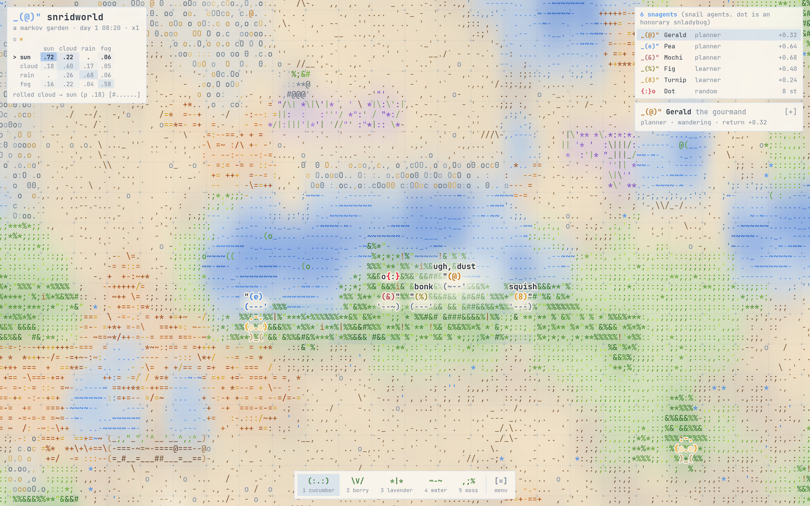
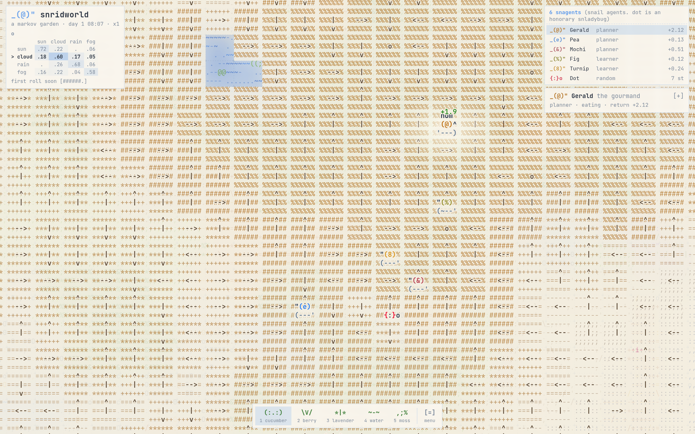
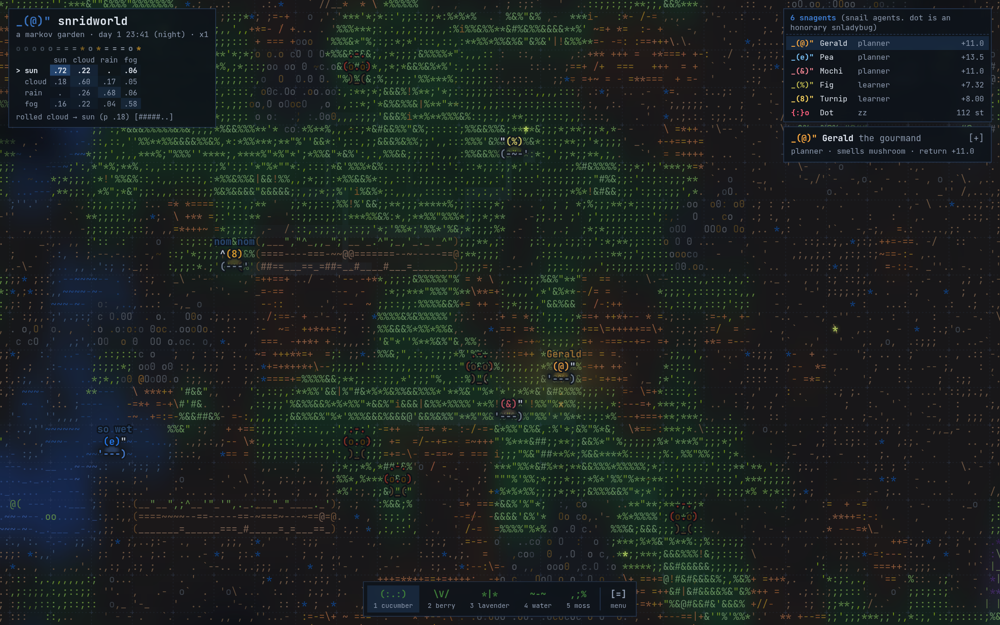
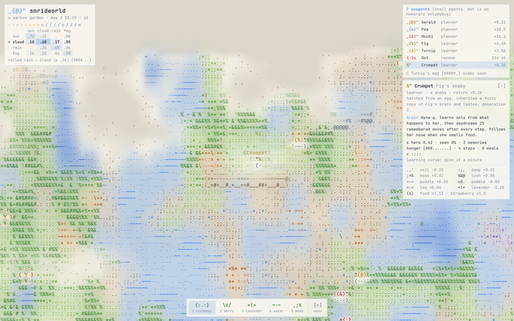

# snridworld

`_(@)"` a markov garden, drawn entirely in ascii.

A gridworld where everything is a little Markov process: the tiles, the weather, the food, and the snails
that live there. The snails are **snagents** (snail agents). Some of them plan with value iteration, some learn
by bumping into things, and one of them is Dot, an honorary **snladybug** who just wanders.



## what's going on

**The garden is a Markov chain.** Every tick, each tile rolls its dice:
P(next type | type, weather, neighbours, elevation). Rain turns dry soil damp and fills the hollows with
puddles, moss spreads from neighbouring moss, sun dries the hilltops first. Hover any square to see its
actual transition probabilities for the next tick.

**The weather is a Markov chain too.** Sun, cloud, rain and fog, with the transition matrix shown in the
corner and the last few rolls in a little history strip.

**Food has its own chain.** Fresh → overripe (fruit flies, worth less) → compost, which turns that square
into lush moss. Mushrooms sprout in fog, rain and at night, especially beside fallen logs.

**The snagents are MDP agents.** Each has its own reward function (dry soil hurts, lush moss is nice,
lavender makes them sneeze, food is a goal), and crawling is stochastic: pebbles get you stuck, leaf
litter makes you veer, puddles make you slide.

| who | brain |
| --- | --- |
| `_(@)"` Gerald, `_(e)"` Pea, `_(&)"` Mochi | **value iteration.** The planners: they know how crawling works and re-plan the whole garden 12 times a second, but only around food they have actually smelled. |
| `_(%)"` Fig | **Dyna-Q.** Learns from what happens to him, then daydreams 25 remembered moves after every step. |
| `_(8)"` Turnip | **plain Q-learning.** Learns only from the single step he just took. He gets there eventually. |
| `{:}o` Dot | **none.** A uniform random walk: a plain Markov chain over tiles. Her visit map converges to its stationary distribution. |

Press `v` to see what the selected snagent believes: a classic gridworld value table with policy arrows.
Learners show `?` where they have never been.



**Life in the garden.** Ripe food gives off scent that drifts about five squares; snagents who smell it
say "smell that?" and head over, and when two of them race for the same cucumber the winner says "mine!"
and the other says "aw". Days and nights cycle: at night snagents curl up and sleep, and fireflies come out.



**Snabies.** After four meals a snail lays an egg. The **snaby** that hatches (a little he or she) inherits a
fuzzy copy of the parent's brain and tastes and a slightly shifted shell colour, and grows up after a couple of minutes. Each
snagent's card has a little ascii learning curve, so you can watch the learners improve.



## controls

| | |
| --- | --- |
| drag, scroll, arrow keys | wander the garden |
| click a snagent (or a name) | select it, `Tab` cycles, `f` follows |
| click the ground | use the current tool: `1` cucumber, `2` strawberry, `3` lavender, `4` water, `5` moss |
| `[=] menu`, or the keys: | |
| `v` | beliefs: values, then policy arrows, then off |
| `w` | force a weather roll |
| `space` / `-` `+` | pause / speed |
| `n` | a new garden |
| `d` | light or dark |

## running it

No build step and no dependencies: it is plain ES modules, so it just needs to be served over http.

```sh
python3 -m http.server 8000
# then open http://localhost:8000
```

## layout

```
index.html          the page, panels and styles
js/util.js          noise, palettes, small helpers
js/grid/world.js    the tile, weather and food chains; the island's shape
js/grid/brain.js    the crawling model (P), value iteration, Q-learning / Dyna-Q, the random walk
js/grid/textures.js how each terrain looks, one character at a time
js/grid/theme.js    light and dark palettes
js/grid/main.js     rendering, snagents, smell, snabies, day and night, input
```

Spun out of snworld, a wall of ascii terrariums.
